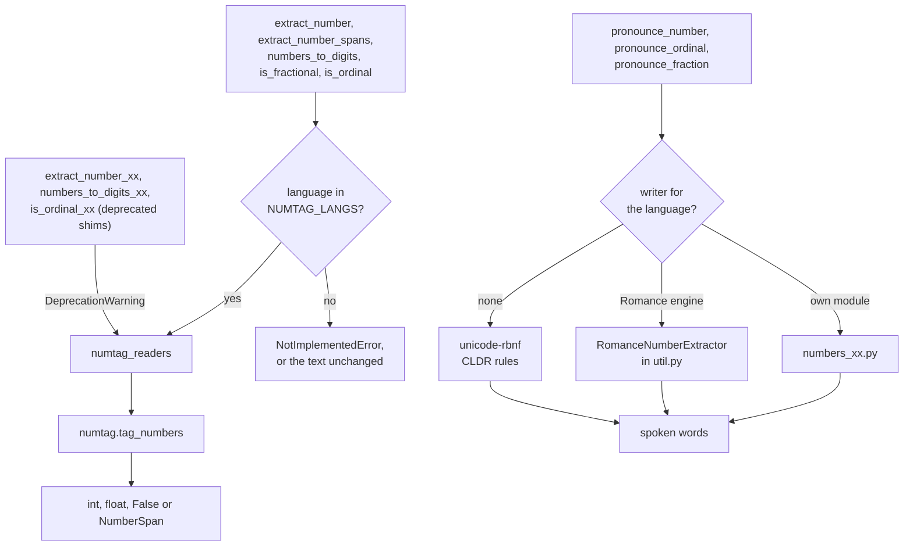
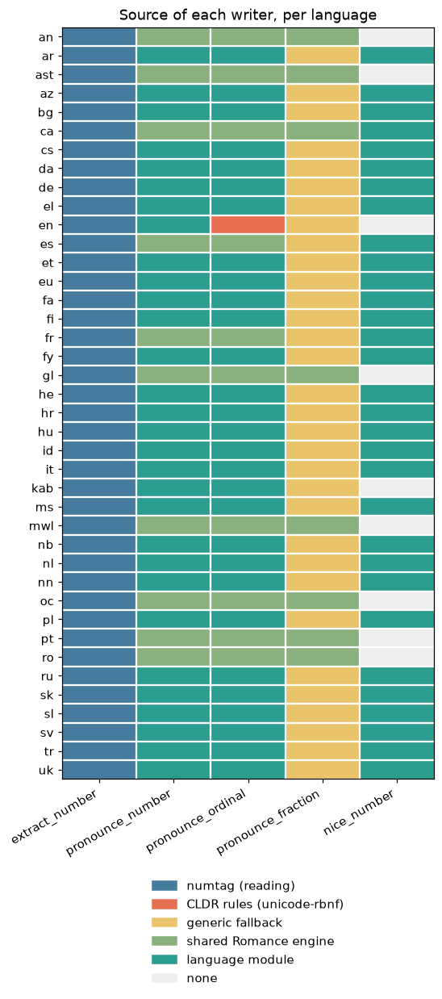

# How it works

<!-- agent-hint
covers: which calls are shims over numtag, which code writes each language, and the path of a call through the package
source: ovos_number_parser/__init__.py (dispatchers), ovos_number_parser/numtag_readers.py, ovos_number_parser/numbers_<code>.py, ovos_number_parser/util.py:RomanceNumberExtractor
generated: no
verify: diff <(.venv/bin/python -I docs/plots/writer_sources.py --table | awk -F'\t' 'NR==1 || $1=="en" || $1=="kab" || $1=="pt"' | tr '\t' '|') <(sed -n '/^\x60\x60\x60text/,/^\x60\x60\x60$/p' docs/how-it-works.md | sed -e 1d -e '$d') && .venv/bin/python -I docs/plots/writer_sources.py --table | awk -F'\t' 'NR>1 && $3=="shared Romance engine"' | wc -l | grep -qx 10
see: api.md, writers.md, languages.md, getting-started.md
-->

This page shows what happens inside the package when you call a public
function. It tells you which calls pass the work to numtag and which code in
this repository writes each language.

## Two halves

The package has a reading half and a writing half.

The reading half turns text into numbers. It is a thin layer over
[numtag](https://github.com/TigreGotico/numtag). `extract_number`,
`extract_number_spans`, `numbers_to_digits`, `is_fractional` and `is_ordinal`
check the language, call numtag, and convert the digit string that numtag
returns to an `int` or a `float`. This package holds no word list for reading.

The writing half turns numbers into words. This package owns it. Each language
has a writer, either a `pronounce_number_<code>` function in its own module or
an engine object built from a `NumberVocabulary`. `pronounce_number`,
`pronounce_ordinal` and `pronounce_fraction` pick the writer by language code.
A language with no writer, such as Japanese, gets its words from the CLDR rules
in [unicode-rbnf](https://github.com/rhasspy/unicode-rbnf).

The top-level functions are the stable API. The per-language names under
`ovos_number_parser.numbers_<code>` are an implementation detail, and the
deprecated reader names among them are shims. A shim calls the numtag reader
and warns.

## The path of a call



Read the diagram from the left box of each row. A reading call goes to numtag
only when the language code is in `NUMTAG_LANGS`. A writing call goes to the
language module or the engine, and to unicode-rbnf only when neither exists
for that value.

## Which calls pass the work to numtag

| Call | Path | Outside the 40 languages |
|---|---|---|
| `extract_number` | numtag | raises `NotImplementedError` |
| `extract_number_spans` | numtag | raises `NotImplementedError` |
| `is_fractional` | numtag | raises `NotImplementedError` |
| `numbers_to_digits` | numtag | returns the text unchanged |
| `is_ordinal` | numtag | looks the text up among the `pronounce_ordinal` forms |
| `extract_number_<code>`, `numbers_to_digits_<code>`, `is_ordinal_<code>` | deprecated shims over the numtag readers | not defined |

[languages.md](languages.md#language-table) lists the 40 codes and
[api.md](api.md#readers-backed-by-numtag) lists the deprecated names.

## Which code writes each language

Every one of the 40 languages has a writer here. A language module writes most
of them. Eight languages use the shared Romance engine for fractions, and
Aragonese, Asturian, Catalan, French, Galician, Mirandese, Occitan, Portuguese,
Romanian and Spanish use it for numbers. English ordinals come from
unicode-rbnf.



The plot shows the source that answered a probe call in each cell. If several
sources answered, the cell shows the last one in the legend order. The reading
column is blue everywhere, because numtag reads all 40 languages. The
`pronounce_fraction` column is yellow for most languages, because the generic
fallback builds the fraction from the `nice_number` wording of the language.

The table behind the plot has one row per language. These rows show English,
Kabyle and Portuguese:

```text
language|extract_number|pronounce_number|pronounce_ordinal|pronounce_fraction|nice_number
en|numtag (reading)|language module|CLDR rules (unicode-rbnf)|generic fallback|none
kab|numtag (reading)|language module|language module|generic fallback|none
pt|numtag (reading)|shared Romance engine|shared Romance engine|shared Romance engine|none
```

Rebuild the plot from the repository root with
`.venv/bin/python docs/plots/writer_sources.py`. The script needs matplotlib.
It runs in a few seconds and prints the table behind the plot. The flag
`--table` prints the table and writes no image.

[writers.md](writers.md) names the functions and engines of each language.

---
[Index](index.md) · [← Adding a language](adding-a-language.md) · [API reference →](api.md)
